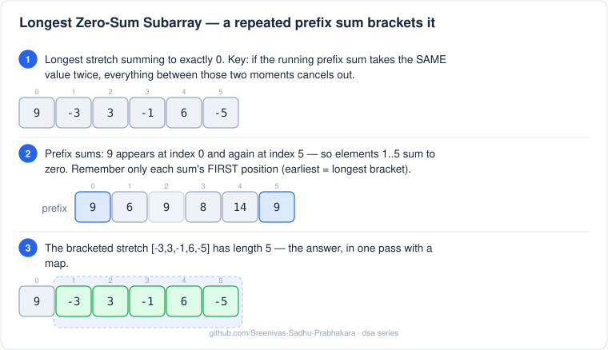

# Largest Subarray with Zero Sum

> Striver SDE Sheet 022 · Day 4 Arrays — prefix sums: a repeated prefix sum brackets a zero-sum stretch; keep only each sum's earliest index. Go, stdlib only, tested.

## Problem

Find the length of the longest contiguous subarray whose elements sum to exactly zero (elements may be negative — that's what makes it interesting; all-positive arrays trivially have none).

## Approach

Running prefix sums. If the prefix sum at index i equals the prefix sum at an earlier index j, everything in between (j+1..i) cancels to zero. So map each prefix sum to the *first* index where it appeared — earliest occurrence maximizes the bracketed length — and on every repeat measure the span. Seeding the map with `{0: -1}` makes subarrays that start at index 0 fall out of the same rule instead of needing a special case.

**Complexity:** O(n) time, O(n) space.

## Visual walkthrough

Read the picture top to bottom — each numbered frame is one moment of the algorithm
running on this repo's test example.

## Run

    go test ./...   # verify
    go run .        # demo

---

One of 191 repos solving Striver's SDE Sheet in Go — stdlib only, one problem per repo, every solution tested. Browse the set: [`dsa-*` repos](https://github.com/Sreenivas-Sadhu-Prabhakara?tab=repositories&q=dsa-&type=source).
